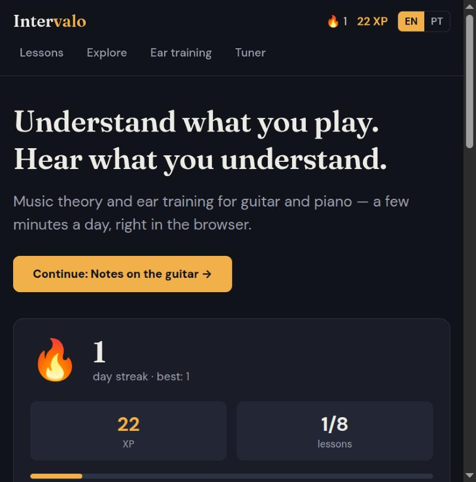
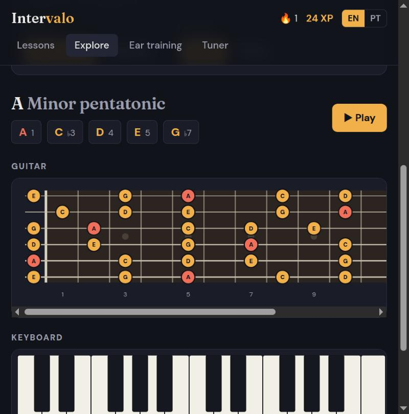
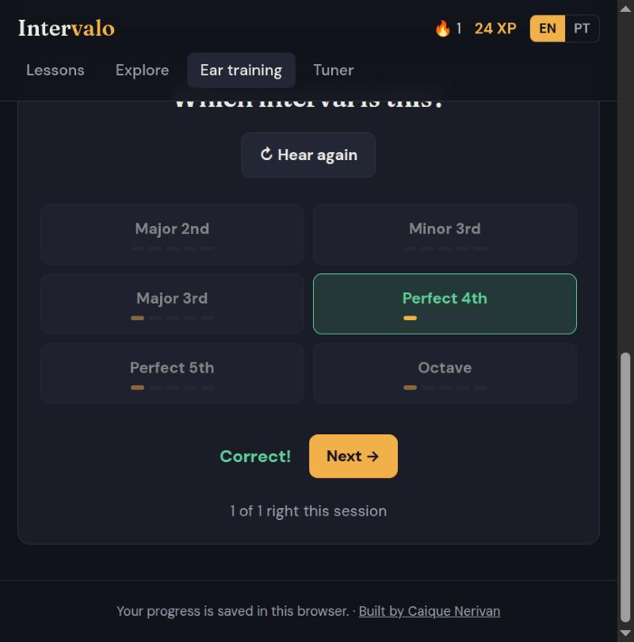
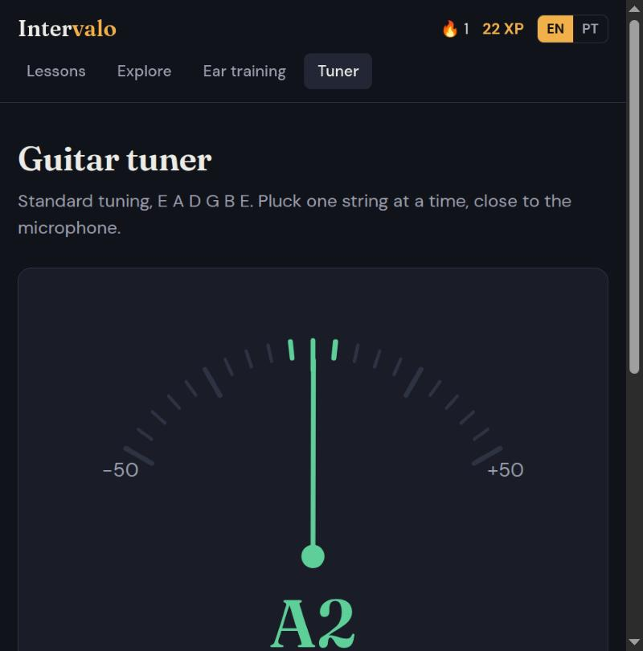
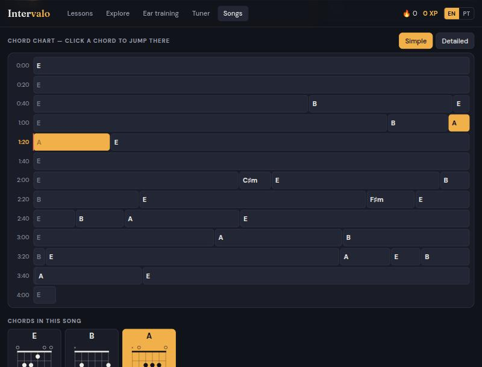
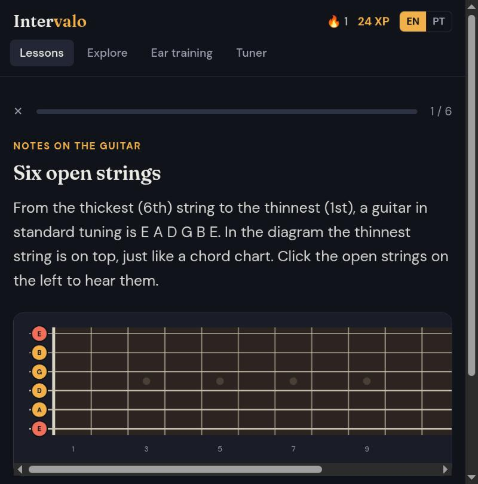

# Intervalo

Music theory and ear training for guitar and piano, in the browser.
*Teoria musical e treino de ouvido para violão e piano, no navegador.*

No account, no backend: everything runs on the device, including the microphone analysis.

| | |
|---|---|
|  |  |
|  |  |
|  |  |

## What it does

1. **Explore** — pick a root and a chord or scale (11 of each) and see it on a guitar fretboard and a keyboard at the same time, as note names or scale degrees. Every fret and key plays.
2. **Ear training** — each level starts with a short lesson: what every interval or chord feels like, a familiar tune to hang it on, and side-by-side examples from the same starting note. Then the app plays one and you name it. Four levels each, scheduled with spaced repetition so what you miss comes back sooner; after a mistake you can hear your answer against the right one.
3. **Tuner** — tunes a guitar from the microphone, detecting pitch with the YIN algorithm.
4. **Lessons** — eight short lessons (notes → intervals → chords → scales) with quizzes, "find this note" exercises and listening rounds. Progress, XP, a daily streak and achievements are saved locally.
5. **Songs** — drop in an MP3 (or WAV, M4A, OGG) and get its chords laid out like a chord sheet that follows the playback, plus the likely key, how far the recording is from standard tuning and a guitar diagram for each chord. Major and minor chords only.

The interface is in English and Portuguese.

## Running it

```bash
npm install
npm run dev      # http://localhost:5173
npm test         # unit tests (Vitest)
npm run build    # production build in dist/
```

The tuner needs `localhost` or HTTPS — browsers only open the microphone in a secure context.

**Deploy:** it is a static site. On Vercel, import the repository and accept the Vite defaults; `vercel.json` already rewrites every route to `index.html` so deep links such as `/tuner` work.

## Stack

React 19 · TypeScript · Vite · Tailwind CSS 4 · Zustand (persisted to `localStorage`) · React Router · Vitest. Audio is the plain Web Audio API, with no audio library.

```
src/
  theory/      notes, intervals, chord/scale formulas, instrument maps — pure functions
  audio/       pitch.ts (YIN), chords.ts (chord recognition), synth.ts (Karplus–Strong guitar, additive piano)
  store/       progress store, spaced repetition, streak, achievements
  components/  Fretboard and Keyboard (SVG), shared UI
  features/    explorer · ear · tuner · lessons · songs · home
  i18n/        en.ts, pt.ts
```

Everything that is logic rather than pixels (`theory/`, `audio/pitch.ts`, `audio/chords.ts`, `store/srs.ts`, `store/streak.ts`) is pure and unit-tested.

## Technical decisions

### Pitch detection: why YIN and not an FFT

The obvious way to find a note is to take an FFT and pick the loudest bin. For a guitar tuner that fails twice:

- **Resolution.** With a 4096-sample window at 48 kHz each bin is ~11.7 Hz wide. Low E is 82.4 Hz and the next semitone is 87.3 Hz — less than half a bin away. A tuner has to resolve *cents*, hundredths of that.
- **The fundamental is often not the loudest partial.** On the wound strings the 2nd harmonic regularly beats the fundamental, so "loudest bin" reports the octave above.

YIN ([de Cheveigné & Kawahara, 2002](http://audition.ens.fr/adc/pdf/2002_JASA_YIN.pdf)) works in the time domain instead. A periodic signal looks like itself when shifted by one period, so the algorithm searches for that shift ([`src/audio/pitch.ts`](src/audio/pitch.ts)):

1. **Difference function** — for each lag τ, `d(τ) = Σ (x[j] − x[j+τ])²`. It is near zero when τ is a period.
2. **Cumulative mean normalisation** — `d'(τ) = d(τ) · τ / Σ d(1..τ)`. Plain `d` is always zero at τ = 0 and small near it; dividing by the running mean removes that bias and makes the result independent of volume.
3. **Absolute threshold** — take the *first* dip below 0.15 and follow it to its local minimum. Multiples of the true period dip just as low, so choosing the first one instead of the global minimum is what prevents octave errors.
4. **Parabolic interpolation** — fit a parabola through the minimum and its neighbours to place it between samples. At 48 kHz a one-sample step at high E (330 Hz) is ~12 cents; interpolation brings the error under 1 cent.

`1 − d'(τ)` doubles as a confidence value ("clarity"), which the tuner uses to drop frames that are attack noise or two strings ringing together.

Around the algorithm, in [`useTuner.ts`](src/features/tuner/useTuner.ts):

- **Browser voice processing is turned off** (`echoCancellation`, `noiseSuppression`, `autoGainControl`). Noise suppression treats a sustained string as background noise and fades it out.
- **Silence gate** on RMS level, so the needle doesn't chase room noise.
- **Median of the last 5 readings** — removes single-frame outliers without the lag of an average. A jump of more than a semitone resets the history, so changing strings is instant.
- The last reading is held for ~1 s while the string decays.
- The microphone signal goes into an `AnalyserNode` only. It is never connected to the output, recorded or sent anywhere.

The window is 4096 samples (≈85 ms, about 7 periods of low E). The inner loop is O(window/2 × max lag), roughly 1.6 M operations per frame, comfortably inside one animation frame without a Web Worker.

Tests feed the detector pure tones, a tone whose 2nd harmonic is louder than the fundamental, noisy signals and synthesised plucked strings for all six open strings.

### Chords from a recording

Finding one pitch (the tuner) and finding a chord in a full mix are different problems: YIN assumes a single periodic source, and a song is many at once. [`chords.ts`](src/audio/chords.ts) uses the classic chroma approach instead:

1. **Decode at 11 kHz.** Chords live below ~2 kHz. `decodeAudioData` on an `OfflineAudioContext` created at 11 025 Hz resamples for free, so there is a quarter of the data and each 4096-sample FFT window spans 0.37 s — bins 2.7 Hz apart, enough to separate semitones down to C2.
2. **Spectral peaks.** Each frame keeps only its local maxima between 65 Hz and 1.4 kHz, with parabolic interpolation for the exact frequency. This drops the noise floor and most of the drums.
3. **Tuning correction.** Recordings are often not at A = 440. The deviation of every peak from its nearest semitone is averaged as a circular mean (it is an angle: +50 and −50 cents are the same place) and removed before rounding to notes.
4. **Chroma, weighted toward the harmony.** Peaks are folded into 12 pitch classes, ignoring the octave. Peaks above ~330 Hz fade progressively and magnitudes are square-rooted, so a loud voice or lead guitar cannot outvote the band. Notes below 180 Hz are also kept apart as a bass chroma.
5. **Median filter over time.** Each pitch class is replaced by its median over about ±1 s. A chord tone is present for the whole chord; a melody note lasts a fraction of a second, so the median never sees it. This was the fix for the first version, which followed the tune instead of the chords.
6. **Template matching.** Each frame is compared (cosine similarity) with the root–third–fifth pattern of the 24 major and minor triads, plus a "no chord" state. The bass chroma adds a vote for the root, since the bass line nearly always plays it, and chords that belong to the estimated key get a small bonus: a song mostly uses the chords of its key, so the others need clearer evidence.
7. **Viterbi smoothing.** Picking the best chord per frame flickers on every passing note. Viterbi finds the sequence with the best total score while charging a fixed cost per chord change, which is what makes the output read like a chord chart.

There are two levels of detail, **Simple** and **Detailed**, which differ in the median window, the change cost and the shortest chord allowed. Without beat tracking there is no single right answer — a bass run between two chords is a chord at one setting and a passing note at the other — so the choice is left to the person. The spectral work is done once (`prepare`), and re-cutting at the other level (`segment`) is instant.

Simple also drops **fills**: a short chord sandwiched between two stretches of the same chord (E – C♯m – E) whose notes fit the chord poorly. On the recording used for tuning this, those were a guitar walk-down in the bass (E–D♯–C♯ with no G♯), not a C♯m. A short chord that is complete — all three notes, little else — is kept.

The key comes from correlating the song's total chroma with the Krumhansl–Kessler key profiles.

**Limits, stated plainly:** it only knows major and minor triads (G7 shows as G), it has no notion of bars or beats, and the automated tests use synthesised progressions (with a louder melody and drums on top, a detuned one), and beyond that it has been checked by ear on a single real recording, not measured against annotated data. Expect it to do well on clear guitar or piano and to struggle with heavy distortion.

The analysis runs on the main thread after decoding: about a second for a short clip, but 7–8 s for a four-minute song, during which the page is frozen. Moving it to a Web Worker is the obvious next step.

### Sound without samples

No audio files are shipped. Guitar notes use **Karplus–Strong** synthesis: a burst of noise loops through a delay line one period long and is low-pass filtered on every pass — which is roughly what a plucked string does. A fractional delay keeps high notes in tune. Piano notes are five decaying sine partials with slight inharmonic stretch. See [`synth.ts`](src/audio/synth.ts).

### Spaced repetition

Each interval or chord quality is a card in a Leitner box ([`srs.ts`](src/store/srs.ts)). A correct answer moves it up a box and schedules it further away (1 min → 10 min → 1 day → 3 days → 7 days); a mistake sends it back to box 1, due now. The next question is the weakest card that is due; when nothing is due, weaker cards are still picked more often. The same sound is never asked twice in a row.

Questions use a random root every time. With a fixed root people learn absolute pitches ("the high one is the fifth") rather than the distance between notes.

### No backend

Progress lives in `localStorage` through Zustand's `persist` middleware, versioned for future migrations. It costs nothing to host and cannot go down. The trade-off is that progress does not follow you across devices; an optional sync could be added later without touching the feature code, since components only talk to the store.

### Note spelling

Chords and scales are spelled with sharps or flats according to the key signature (F major shows B♭, G major shows F♯; minor formulas borrow from the relative major). It does not use double accidentals or E♯/C♭, so a few remote keys are spelled enharmonically.

## Not in this version

- Recognising chords played live on the microphone, and following along with songs.
- Seventh and extended chords, beat/bar detection and lyrics in the song analysis.
- Alternate tunings and a chromatic tuner mode.
- Accounts and cross-device sync.
